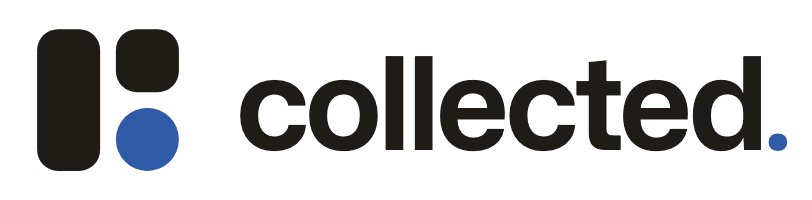
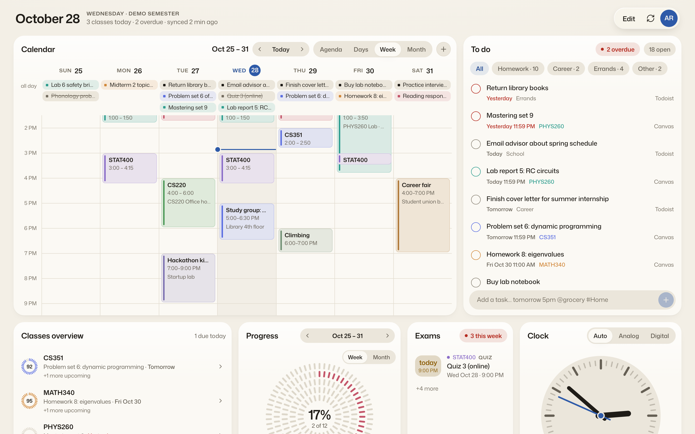
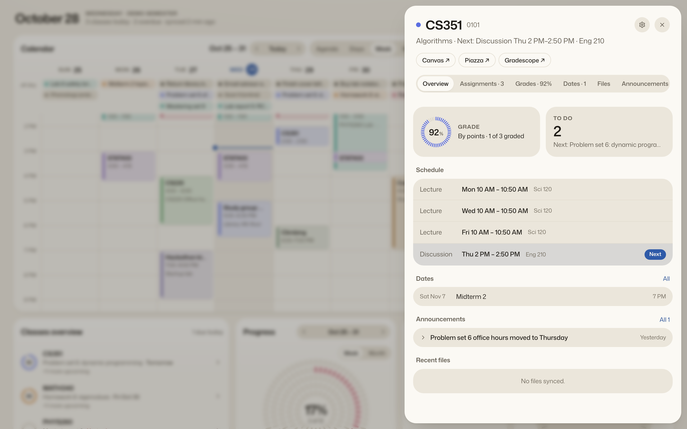
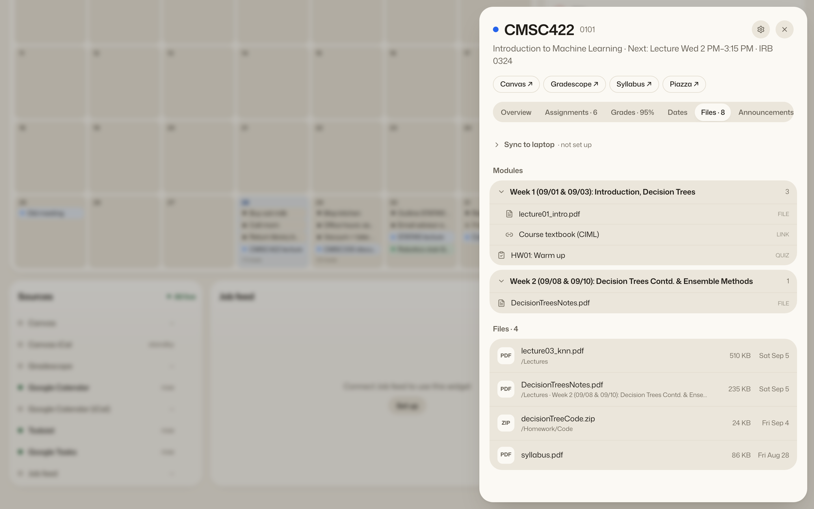
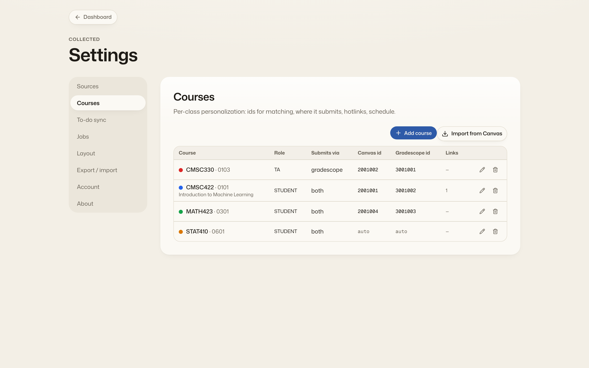
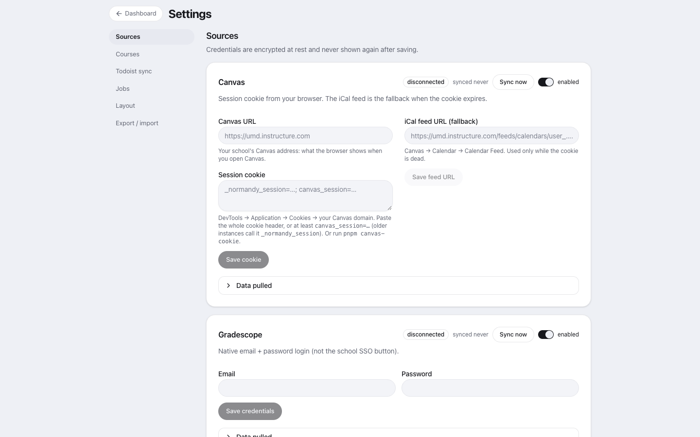

<h1 align="center">
  <picture>
    <source media="(prefers-color-scheme: dark)" srcset="docs/brand/logo-dark.png">
    
  </picture>
</h1>

<p align="center">
  <a href="https://collected.priyamkabra.com">Website</a> ·
  <a href="#run-it">Install</a> ·
  <a href="#features">Features</a> ·
  <a href="docs/self-host.md">Self-host</a> ·
  <a href="https://collected.priyamkabra.com/privacy">Privacy</a> ·
  <a href="CHANGELOG.md">Changelog</a> ·
  <a href="mailto:admin@priyamkabra.com">Contact</a>
</p>

<p align="center">
  <a href="https://www.npmjs.com/package/collected-cli"></a>
  <a href="https://github.com/priyam-k/collected/actions/workflows/ci.yml?query=branch%3Amain"></a>
  <a href="https://github.com/priyam-k/collected/pkgs/container/collected"></a>
  <a href="LICENSE"></a>
  <a href="https://nodejs.org"></a>
</p>

One dashboard for everything a student juggles. collected copies your Canvas assignments, Gradescope submissions, Google Calendar, Todoist tasks and a public internship feed into one copy that is yours, and shows them as a grid of widgets you can rearrange: a week calendar, a to-do list that knows what you have already submitted, one row per class, a job feed with an applications tracker. It never owns the data (Canvas stays the truth about assignments, Google about events) and never writes back except where you ask it to. Run it on your laptop with nothing but Node (`collected init --local`: no server, no Docker, no Google Cloud project), on a small server of your own, or on the hosted beta. The `collected` CLI reads the same data from the terminal, keeps your course files sorted into folders on your laptop, and comes with an agent skill so Claude Code or any other agent can answer "what's due this week".

<p align="center">
  
</p>
<p align="center">
  
  
</p>
<p align="center">
  
  
</p>

## Features

**Sources.** Canvas (assignments, planner, announcements, modules, files, grades, with the iCal feed as a fallback), Gradescope (student submissions and, if you TA, the grading queue), Google Calendar (incremental sync, quick-add events), Todoist (tasks, labels, and an optional one-way push of assignments into a project), and an internship feed (the public Simplify listings, filtered by your own rules). Each source syncs on its own timer, fails on its own, and reports its status; a dead scraper degrades one panel, never the app.

**Widgets.** Calendar (agenda, day, week, month), to-do (open tasks and assignments, grouped, with "done here only"), classes overview, sources, job feed, applications tracker, and smaller ones. Every widget renders at every size; drag and resize them in edit mode; layouts are saved per breakpoint, and the mobile view stacks them.

**Course panes.** Click a class for its grade (recomputed Canvas-style from assignment groups, with your own syllabus weights if Canvas is wrong), schedule and next meeting, exam and quiz dates, announcements, syllabus, modules and files, and the assignments split into to-do and done. Linked Canvas and Gradescope rows for the same homework collapse into one.

**File sync and CLI.** `collected-cli` on your laptop pulls new course files from Canvas into folders you name, sorted by rules you write (or a small decision model for the rest), and writes a per-course index plus assignments and announcements as Markdown. The same CLI reads your agenda, grades and announcements, and makes small edits (tasks, notes, hotlinks, dates). In local mode it is the whole app: the backend runs inside the command over a SQLite database in `~/.collected`, and `collected ui` serves the dashboard on this machine.

**Agent-friendly.** Every CLI read takes `--json`, the API is plain resource-shaped JSON, a [skill file](skills/collected/SKILL.md) tells an agent which commands are safe, and the Markdown the file sync writes is meant to be read by whatever note-taking or AI tooling you point at the folder.

## Run it

Three ways, from least to most setup.

### On your laptop

Needs Node 22.12 or newer and nothing else.

```sh
npm i -g collected-cli
collected init --local                # no server: a SQLite database in ~/.collected/data
collected connect canvas              # reads your Canvas session from the browser and syncs
collected connect google calendar     # Google's consent screen in your browser; no Google Cloud project
collected ui                          # the dashboard at http://127.0.0.1:4848
```

Local mode runs the same backend a server runs, inside the CLI, so every command and the whole dashboard work on one machine with no server, Docker, domain or OAuth client, and the data stays in `~/.collected`. The dashboard keeps sources syncing while it is open, a read such as `collected agenda` syncs a stale source before it answers, and `collected daemon install` adds a user timer that runs `collected sync` (every source, then the course files) every 15 minutes in the background. `collected demo canvas` loads fixture data if you want to look around first. Every command, `~/.collected/.env` and the freshness rules: [`agent/README.md`](agent/README.md#local-mode).

### Self-host

One container, one SQLite file in `./data`, for when you want the board on your phone and every other device. You need an always-on Linux box with Docker (1 GB of RAM is enough) and a domain, or a Cloudflare Tunnel if the box cannot take inbound connections. The compose file pulls the prebuilt image `ghcr.io/priyam-k/collected`, so nothing is compiled on the box.

```sh
git clone https://github.com/priyam-k/collected.git && cd collected
cp .env.example .env            # set PUBLIC_URL, TZ, and the Google OAuth client for sign-in
mkdir -p data && sudo chown 1000:1000 data
docker compose pull             # ghcr.io/priyam-k/collected:latest
docker compose up -d            # listens on 127.0.0.1:3000; put Caddy or a Cloudflare Tunnel in front
```

The app has its own Google sign-in (the first person to sign in owns the instance); Cloudflare Access in front of it is optional. The full walk-through, covering TLS with Caddy or a tunnel, the Google OAuth client, connecting each source, backups and updates (the app tells you when a new version is out), is in [`docs/self-host.md`](docs/self-host.md). Then open the site, go to Settings → Sources and connect each account.

### Hosted

An invite-only beta: sign in and connect your accounts without running anything. [Join the waitlist](mailto:admin@priyamkabra.com?subject=collected%20waitlist) and say which school you are at; what it can connect to depends on it.

### Local development

Needs Node 22.12+ and pnpm.

```sh
npm i -g pnpm
pnpm install --frozen-lockfile
cp .env.example .env            # set AUTH_DISABLED=true; leave SECRET_KEY empty
pnpm cli demo canvas            # fixture data so the widgets are not empty (also: gradescope, gcal, todoist, gtasks)
pnpm dev                        # server on :3000, web on :5173
```

Open http://localhost:5173/dashboard for the board (`/` is the public home page). Useful afterwards:

```sh
pnpm sync canvas               # run one ingester now (also: gradescope, gcal, todoist, jobs, all)
pnpm cli push --dry-run        # preview the Todoist push
pnpm cli export > backup.json  # courses, settings, layout (no secrets)
pnpm cli demo clear            # remove the demo rows
pnpm -r typecheck && pnpm -r test
```

The backend lives in `core/` (database, ingesters, syncs, scheduler); `server/` is the HTTP layer over it, and the CLI in `agent/` runs the same core in-process for local mode.

## CLI and file sync

```sh
npm i -g collected-cli
collected init --local                          # the whole app on this machine; or: collected init https://collected.example.com && collected login
collected connect canvas                        # reads the Canvas session from your browser (into the local database, or posted to your server)
collected files link cs101 ~/School/CS101       # where this course's files should land
collected sync                                  # everything this machine keeps current: sources (local mode), then course files; `collected daemon install` runs it on a timer
collected agenda                                # what is due this week (`--fresh` to sync first, `--stale-ok` to never wait)
collected help
```

The same commands work in local mode and against a server; in local mode `collected ui` is the dashboard and `collected sync <source|all>` runs a source sync in-process. The server (or the local database) stores only the *names* of your target folders; the paths live in `~/.collected/agent.json` on your machine. Nothing the server says can make the CLI write outside a folder you linked, and a file you edited after it was placed is never overwritten. `collected --version` prints the version and `collected upgrade` installs the newest one with whatever installed this one. Details and every command: [`agent/README.md`](agent/README.md).

## For AI agents

`skills/collected/SKILL.md` teaches an agent (Claude Code, or anything that reads a skill file) what the `collected` CLI can do, which commands are safe to run freely and which change things. Copy it into your agent's skills folder (for Claude Code: `~/.claude/skills/collected/SKILL.md`) and the agent can answer "what's due this week" or "add an exam date" through the CLI. It works the same in local mode, where reads come straight from the database on your laptop: the skill tells the agent to pass `--stale-ok` on repeated calls, `--fresh` when you ask for the latest, and to suggest `collected upgrade` when a version notice shows up.

## Security

See [SECURITY.md](SECURITY.md) for how to report a vulnerability. The trust model in four lines:

- Credentials (Canvas cookie, Gradescope password, Google and Todoist tokens) are AES-256-GCM encrypted at rest and never returned by the API or written to logs.
- The laptop never trusts the server for a filesystem path: targets are validated against the names you configured, every write is checked to be inside the linked folder, and downloads follow only `https` redirects to public hosts.
- Every outbound URL the server fetches is validated (`https`, public host), bounded in time and size, and pinned to its origin across redirects and pagination.
- CLI tokens are scoped: a service token can do what the CLI needs and nothing destructive; the helper key opens a single route.

## Docs

[`artifacts/OVERVIEW.md`](artifacts/OVERVIEW.md) is the backend in ten minutes, [`artifacts/DESIGN.md`](artifacts/DESIGN.md) the spec, [`artifacts/REFERENCE.md`](artifacts/REFERENCE.md) every route and column, [`artifacts/DECISIONS.md`](artifacts/DECISIONS.md) the why, [`docs/self-host.md`](docs/self-host.md) running your own instance, [`agent/README.md`](agent/README.md) the CLI and local mode, [`CONTRIBUTING.md`](CONTRIBUTING.md) how to send a change, [`docs/releasing.md`](docs/releasing.md) how the CLI is published.

## License

[AGPL-3.0-only](LICENSE). If you run a modified version for other people, you have to offer them the source.
